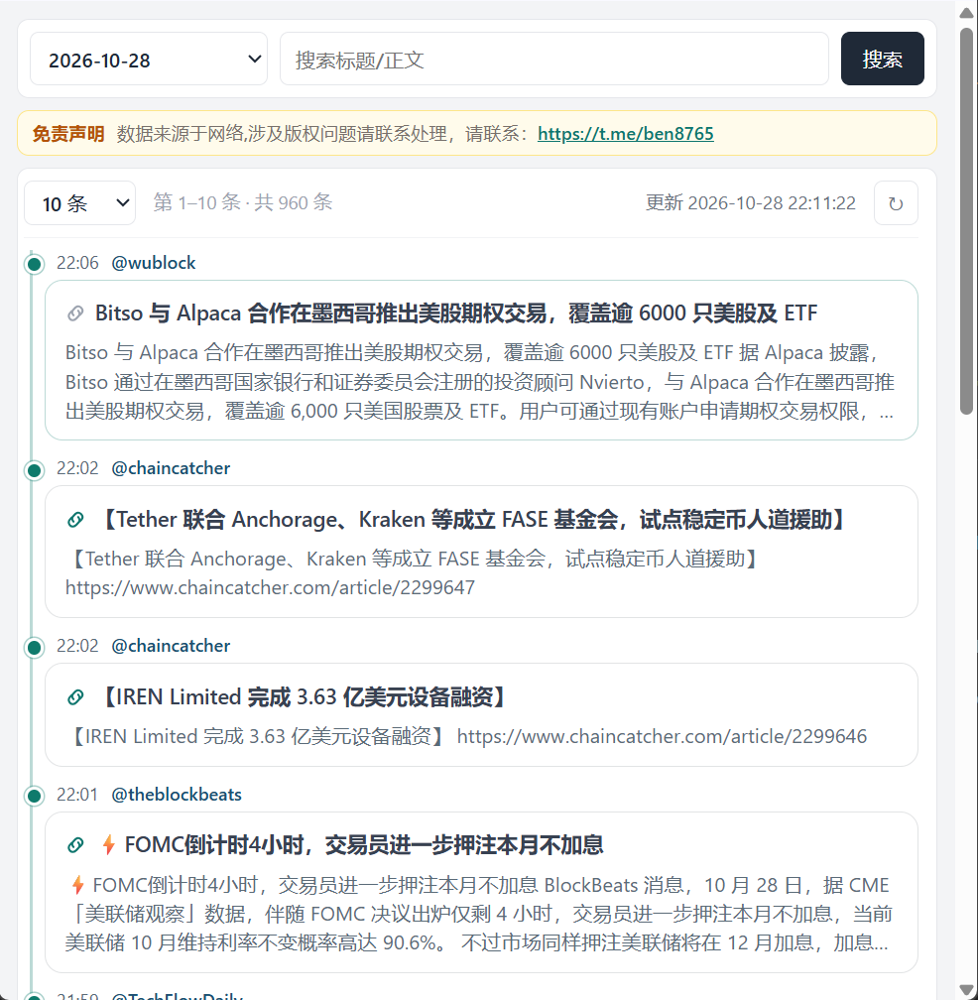

# Crypto News CN · 币圈新闻资讯

> 聚合多家一线媒体 · 一条时间线扫完中文币圈热点

**在线体验：** [http://news.ho21.com/web3](http://news.ho21.com/web3)

---

## 核心优点

- **集合多家新闻，一站看完**  
  不用再开十几个 App / 频道来回刷。WuBlock、ChainCatcher、BlockBeats 等一线来源汇入同一条时间线，少漏报、少刷屏。

- **按时间排序，快讯节奏清晰**  
  竖向时间轴 + 时分戳，几秒判断「刚才发生了什么」，适合盯盘间隙扫一眼。

- **标题 + 正文都能搜**  
  搜币种、项目名、融资、监管关键词，标题和正文一起命中，复盘题材更快。

- **按日期筛选，方便复盘**  
  切到某一天即可回看当日全量快讯，写笔记、对行情、做日报都省事。

- **来源透明，可溯源**  
  每条标明出处媒体 / 账号，需要核对原文时一眼就知道去哪看。

- **界面干净，信息密度高**  
  时间线卡片布局，少广告干扰；支持 10 / 20 / 50 / 100 条分页，刷新时间一目了然。

---

## 这是什么？

**Crypto News CN** 面向中文 Web3 / 加密货币用户的资讯聚合站：把多家主流区块链媒体的快讯汇总、按时间排列，并提供搜索与按日筛选，方便交易者、研究员和自媒体快速过市场信息。

---

## 功能一览

| 能力 | 说明 |
|------|------|
| 多源聚合 | 多家一线媒体合进一条时间线 |
| 实时时间线 | 按发布时间展示，更新时间可见 |
| 全文搜索 | 同时匹配标题与正文 |
| 按日筛选 | 日期选择器切到任意一天 |
| 来源标注 | 每条显示出处，便于溯源 |
| 分页刷新 | 条数可选，一键 ↻ 拉最新 |

---

## 适合谁用？

- **交易者**：开盘前后、波动时段快速扫快讯，少漏重要消息
- **研究员 / 自媒体**：按日复盘、按关键词挖题材线索
- **项目方 / 运营**：盯融资、合作、宏观与监管动态

---

## 使用方式

1. 打开 [http://news.ho21.com/web3](http://news.ho21.com/web3)
2. 选日期，或输入关键词 → 点「搜索」
3. 需要最新数据时点右上角 **↻** 刷新

免责声明与版权咨询见站点页头；联系 Telegram：[ben8765](https://t.me/ben8765)

---

## 资讯覆盖（示例）

- 交易所 / 券商合作与产品上线  
- 融资、基金与机构动态  
- 上市公司与矿企资本运作  
- FOMC 等宏观与利率预期  

---

## 商务合作

站点背后持续汇聚中文币圈多源资讯。若你需要把这些能力接到自己的产品、投研或运营流程里，欢迎洽谈：

| 合作方向 | 能做什么 |
|----------|----------|
| **数据订阅** | 按日 / 按源 / 按主题提供结构化资讯数据（JSON / 接口），对接你的库表、看板或内部检索 |
| **数据推送** | 新快讯实时或准实时推送（Webhook / WebSocket / 消息队列等），驱动告警、机器人、内容分发 |
| **数据挖掘** | 关键词/题材聚类、情感与热度、实体抽取（项目/人物/机构）、复盘报表与定制分析 |
| **定制接入** | 白标展示页、指定媒体源增补、私有关键词监控、与现有交易/CRM/内容系统对接 |

适合：量化 / 投研团队、交易所与钱包运营、资讯 App、自媒体矩阵、风控与舆情监测等。

**联系合作：** Telegram [https://t.me/ben8765](https://t.me/ben8765)  
请备注「数据合作」+ 大致需求（订阅 / 推送 / 挖掘），便于尽快对接。

---

## 仓库说明

本仓库用于展示与宣传线上站点 [news.ho21.com/web3](http://news.ho21.com/web3)。

日常反馈与商务合作同一联系方式：Telegram [ben8765](https://t.me/ben8765)

---

## License

展示用途。站点内容版权归原媒体 / 作者所有；转载或商用请先与作者沟通。
